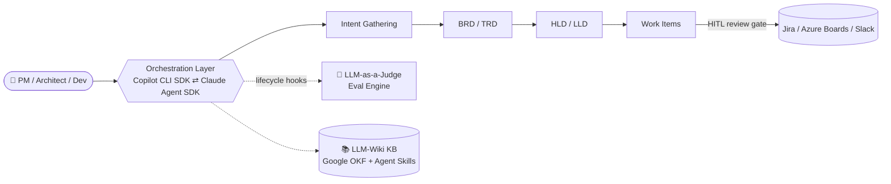

<!-- ═══════════════════════════ HEADER ═══════════════════════════ -->
<div align="center">


<a href="https://git.io/typing-svg">
  
</a>

<br/>

<a href="https://www.linkedin.com/in/rtopdar/"></a>
<a href="mailto:rounak2002topdar@gmail.com"></a>
<a href="https://drive.google.com/file/d/1aMOiGoRoqfUSAqyrJSJx40F25zu3V60O/view?usp=sharing"></a>


</div>

---

## 🧠 About Me

```python
class RounakTopdar:
    role       = "Senior GenAI Engineer @ EY GDS (AI & Data Consultant)"
    based_in   = "Kolkata, India 🇮🇳"
    experience = "3+ years shipping production-grade agentic AI"
    domains    = ["Media Compliance", "Banking", "Risk Consulting", "Customer Support"]

    focus = {
        "agentic_ai":    ["Multi-agent orchestration", "MCP", "A2A", "Harness engineering"],
        "retrieval":     ["RAG over SQL/NoSQL vector stores", "Vectorless RAG", "LLM-Wiki / OKF"],
        "reliability":   ["LLM-as-a-judge evals", "Langfuse", "Guardrails", "HITL review gates"],
        "cloud":         ["Azure Container Apps", "Durable Functions", "App Insights", "CI/CD"],
    }

    def philosophy(self):
        return "No black boxes. Every agent instrumented, evaluated and shipped."
```

I turn ambiguous business problems into **deployed, measurable GenAI systems** — from architecture and agent design to evaluation pipelines and cloud rollout.

---

## 🚀 Flagship Work

<details open>
<summary><b>🏗️ Full-Scale PDLC Orchestration Platform</b> — GitHub Copilot CLI SDK + Claude Agent SDK</summary>
<br/>

An end-to-end **Product Development Lifecycle** platform where PMs, architects and developers collaborate through *markdown-as-source-of-truth* documents — driven by a dual AI orchestration layer.



- 🔒 **Secure, isolated agent instances** per team/session with strict tenant & data isolation
- 🧪 Custom **eval engines** on lifecycle event hooks — tool-call monitoring + LLM-as-a-judge at every stage
- ✋ **Human-in-the-loop gates** before docs become tracked work items
- ⚡ LLM-wiki knowledgebase cut incident resolution to **3–10 min** for L1/L2/L3 engineers

</details>

<details>
<summary><b>🎙️ No-Code Voice Multi-Agent Platform</b> — Enterprise Customer Support</summary>
<br/>

- Context-aware voice agents (OpenAI Agents SDK + Realtime API) across **retail, e-commerce & healthcare**, with **Twilio IVR** and HITL escalation on low confidence
- Multi-layered memory: in-session, cross-session summary, per-user long-term
- Observability via **App Insights + structlog + Langfuse**, sentiment analysis, **Temporal**-orchestrated summarisation
- PII redaction, harmful-content filtering, output verification; per-user **token budgets with circuit breakers**
- Stateless backend on **Azure Container Apps** with session affinity & horizontal autoscaling

</details>

<details>
<summary><b>🧩 No-Code Agentic Workflow Builder</b> — Enterprise Departments</summary>
<br/>

- Cross-department multi-agent workflows on **Microsoft Agent Framework**, model-agnostic (incl. local / fine-tuned LLMs)
- **MCP servers + A2A** interop with per-department isolated vector DBs
- Smart orchestrator handoff for sub-agent delegation; operator HITL portal
- Three-portal architecture (admin / operator / end-user) on microservices with automated failover

</details>

<details>
<summary><b>📄 Marketing Compliance Document Processing</b></summary>
<br/>

- Re-architected a monolith into **microservices** for independent deployment & targeted scaling
- Document processor as an **MCP client** to compliance tooling servers; long-running pipelines on **Azure Durable Functions** with **SSE** progress streaming

</details>

---

## 🛠️ Tech Stack

<div align="center">

**🤖 Agentic AI & LLM Frameworks**


**🔌 Protocols · Context · Evals**


**⚙️ Languages · Backend · Frontend**


**☁️ Cloud · Data · DevOps**


**🧑‍💻 Coding Agents I work with daily**


</div>

---

## 💼 Experience

| 🏢 Company | 🎯 Role | 📅 Period |
|---|---|---|
| **EY Global Delivery Services LLP** | AI & Data Consultant, Technology Consulting — leading GenAI platform builds | Feb 2025 – Present |
| **AlphaDnA / Gnosis Lab** | Associate Software Developer · Full Stack Application Consultant | Aug 2023 – Feb 2025 |

<details>
<summary><b>Highlights from AlphaDnA / Gnosis Lab</b></summary>
<br/>

- 📈 Asset-visualization platform (MongoDB + Express.js) → **+20% decision speed**, **−50% API response time**
- 🔐 Okta OIDC auth with multi-level access control + audit logging
- ☁️ GCP deployment pipelines and a **zero-disruption migration to AWS**
- 🛍️ React product catalog with Python REST APIs + **Milvus** embedding-based recommendations
- 📄 Legal document translation platform on Firebase with Google SSO passwordless auth

</details>

---

## 🏅 Certifications

<div align="center">

| Certification | Issuer |
|---|---|
| 🤖 Azure AI Apps and Agents Developer Associate (**AI-103**) | Microsoft |
| 🧠 Azure Agentic AI Fundamentals (**AI-901**) | Microsoft |
| ⚡ [Azure Developer Associate (**AZ-204**)](https://learn.microsoft.com/api/credentials/share/en-gb/RounakTopdar-6363/7DBFE9C5F4EF9C5E?sharingId=A172CAF2E331B36) | Microsoft |
| ☁️ [Azure Fundamentals (**AZ-900**)](https://learn.microsoft.com/api/credentials/share/en-gb/RounakTopdar-6363/4DDD2701CE52B57B?sharingId=A172CAF2E331B36) | Microsoft |
| 🧱 Databricks Certified Generative AI Engineer Associate | Databricks |
| 🐙 [GitHub Copilot (**GH-300**)](https://learn.microsoft.com/api/credentials/share/en-gb/RounakTopdar-6363/638C6B0EBDB6FBBF?sharingId=A172CAF2E331B36) | GitHub |
| 🌱 [GitHub Foundations (**GH-900**)](https://learn.microsoft.com/api/credentials/share/en-gb/RounakTopdar-6363/34BA532001B2617C?sharingId=A172CAF2E331B36) | GitHub |
| 📮 30 Days of Postman | Postman |

🎓 **B.Tech, Computer Science & Engineering** — University of Engineering and Management, Kolkata (2019–2023) · GPA 8.36 / 10

</div>

---

## 📊 GitHub Analytics

<div align="center">


</div>

---

## 🌱 Currently Exploring

- 🔍 Advanced RAG — hybrid search, query routing, dynamic context windows
- 🧬 Domain fine-tuning with LoRA / QLoRA
- 🛡️ LLM security — prompt-injection defence & jailbreak detection
- 📡 Real-time AI monitoring at enterprise scale
- 🇩🇪 German — working toward B2

---

## 🐍 Contribution Snake

<div align="center">
<picture>
  <source media="(prefers-color-scheme: dark)" srcset="https://raw.githubusercontent.com/RTopdar/RTopdar/output/github-contribution-grid-snake-dark.svg"/>
  <source media="(prefers-color-scheme: light)" srcset="https://raw.githubusercontent.com/RTopdar/RTopdar/output/github-contribution-grid-snake.svg"/>
  
</picture>
</div>

---

<div align="center">

### 🤝 Let's build production-grade GenAI together

<a href="https://www.linkedin.com/in/rtopdar/"></a>
<a href="mailto:rounak2002topdar@gmail.com"></a>

<sub>⚡ Always learning, always shipping ⚡</sub>


</div>
